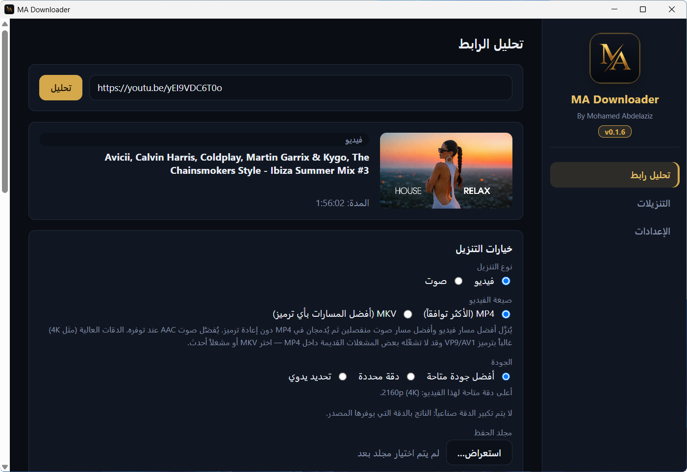

<div align="center">


# MA Downloader

**A fast, lightweight Windows desktop app to download video and audio with a clean bilingual (Arabic / English) interface.**

[](https://github.com/m4whw/MA-Downloader/releases/tag/v0.1.6)
[](#system-requirements)
[](#license-and-terms)

[**⬇ Download v0.1.6 (x64 Setup)**](https://github.com/m4whw/MA-Downloader/releases/download/v0.1.6/MA.Downloader_0.1.6_x64-setup.exe) · [Release notes](https://github.com/m4whw/MA-Downloader/releases/tag/v0.1.6) · [Changelog](CHANGELOG.md) · [العربية ↓](#الدليل-بالعربية)



</div>

## Download

| | |
|---|---|
| **Version** | v0.1.6 |
| **Installer** | `MA.Downloader_0.1.6_x64-setup.exe` (NSIS, per-user install) |
| **Size** | 84,258,265 bytes (~80 MiB) |
| **SHA-256** | `72d87094c4d374baee300459189b11335be5062f0360561f91a36016a3508e00` |

Verify the file before running it:

```powershell
Get-FileHash .\MA.Downloader_0.1.6_x64-setup.exe -Algorithm SHA256
```

> **Windows SmartScreen:** the installer is not code-signed, so Windows may show "Windows protected your PC". Compare the SHA-256 above, then choose **More info → Run anyway**.

## Features

- **Video and audio downloads** powered by a bundled yt-dlp engine; MP4 or MKV for video, MP3 extraction for audio.
- **Playlists:** analyze a whole playlist or download a custom range (for example `1-10`).
- **Quality control:** best available, a chosen resolution, or manual stream selection. Resolution is never upscaled.
- **Download manager:** live progress, speed and ETA, with pause, resume and cancel; history and quick "open file / open folder".
- **Zero extra installs:** yt-dlp, FFmpeg and Deno ship inside the installer. No Python or command line needed.
- **Arabic and English UI** with full right-to-left layout, and dark / light themes.
- **Integrity checks:** the bundled yt-dlp, FFmpeg and Deno are SHA-256 verified at startup and before each launch.
- **Safe by design:** strict content-security policy, validated URLs and paths, no shell execution, single running instance, child processes ended when the app closes.
- **Private:** no telemetry, no analytics, no account. Settings and history stay on your PC.

## System requirements

- Windows 10 (1809+) or Windows 11, 64-bit (x64)
- Microsoft Edge WebView2 runtime (preinstalled on current Windows 10/11)
- About 250 MB free disk space for the app, plus space for your downloads
- Internet connection for analysis and downloads

**Bundled components:** yt-dlp 2026.10.26 · FFmpeg 9.0.2 (gyan.dev essentials build) · Deno 2.9.8 · Tauri v2 · React / TypeScript.

## Install and use

1. Download the installer and (optionally) verify its SHA-256.
2. Run it and follow the wizard; launch **MA Downloader** from the Desktop or Start Menu.
3. Paste a video or playlist link and press **Analyze**.
4. Choose video or audio, format, quality and the save folder.
5. Start the download and follow it in the **Downloads** tab.

## Troubleshooting

- **SmartScreen warning:** expected for unsigned software; verify the hash and use *Run anyway*.
- **Status stays on "Processing":** merging or MP3 conversion runs locally with FFmpeg and can take a moment on large files.
- **Temporary rate limits from the host site:** wait a few minutes or change network.
- **WebView2 missing (old Windows 10):** install the Evergreen runtime from Microsoft.
- **Private, members-only or age-restricted content** is not supported.

## Privacy and responsible use

MA Downloader sends nothing to the author. Use it only for content you own, content under permissive licenses (e.g. Creative Commons, public domain), or where the law and the host platform's terms allow offline copies. You are responsible for complying with copyright law and the terms of service of any site you use.

## License and terms

Free desktop software for personal, non-commercial and educational use, provided "as is" without warranty. Third-party components (yt-dlp, FFmpeg, Deno, Tauri, React) remain the property of their authors under their own licenses. This repository hosts the download page and release installers only.

## Links

[Releases](https://github.com/m4whw/MA-Downloader/releases) · [Issues](https://github.com/m4whw/MA-Downloader/issues) · [Landing page](https://m4whw.github.io/MA-Downloader/) · [mohamed-abdelaziz.com](https://mohamed-abdelaziz.com/en/learning/tools/ma-downloader)

---

<a id="الدليل-بالعربية"></a>

<div dir="rtl">

## الدليل بالعربية

**MA Downloader** تطبيق مكتبي مجاني لويندوز لتنزيل الفيديو والصوت بواجهة حديثة تدعم العربية بالكامل (من اليمين إلى اليسار) والإنجليزية.

### التنزيل

- **الإصدار:** v0.1.6 — [تحميل المثبّت (x64)](https://github.com/m4whw/MA-Downloader/releases/download/v0.1.6/MA.Downloader_0.1.6_x64-setup.exe)
- **الحجم:** 84,258,265 بايت (حوالي 80 ميجابايت)
- **بصمة SHA-256:** `72d87094c4d374baee300459189b11335be5062f0360561f91a36016a3508e00`
- ⚠️ المثبّت غير موقّع بشهادة تجارية، فقد تُظهر SmartScreen تحذيراً: طابق البصمة ثم اختر **More info ← Run anyway**.

### المميزات

- تنزيل فيديو (MP4 / MKV) وصوت (MP3) عبر محرك yt-dlp المدمج.
- قوائم التشغيل كاملة أو بنطاق محدد (مثل `1-10`)، ولا تُكبَّر الدقة صناعياً.
- مدير تنزيلات: تقدم وسرعة ووقت متبقٍ، مع إيقاف مؤقت واستئناف وإلغاء وسجل وفتح الملف أو المجلد.
- يتضمن yt-dlp وFFmpeg وDeno دون الحاجة لتثبيت أي شيء آخر.
- واجهة عربية وإنجليزية ومظهر داكن وفاتح.
- فحص سلامة الملفات المرفقة (SHA-256)، وحماية CSP، وتحقق من الروابط والمسارات، بلا تتبع ولا إحصاءات.

### المتطلبات

ويندوز 10 (1809+) أو 11 بمعمارية 64-bit، وبيئة WebView2، ومساحة حوالي 250 ميجابايت.

### الاستخدام

الصق الرابط ← **تحليل** ← اختر النوع والصيغة والجودة ومجلد الحفظ ← ابدأ التنزيل وتابعه من تبويب **التنزيلات**.

### إخلاء مسؤولية

للاستخدام الشخصي والتعليمي وللمحتوى المملوك لك أو المرخّص بحرية. المستخدم مسؤول عن الالتزام بحقوق الملكية وشروط المنصات.

</div>
