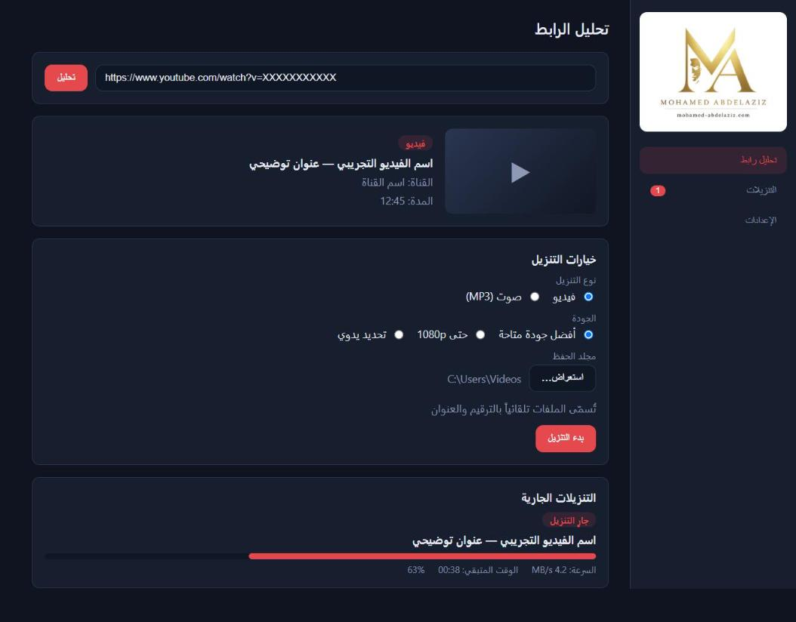

# MA Downloader

[-0078D6.svg)](https://github.com/m4whw/MA-Downloader/releases/tag/v0.1.3)

**MA Downloader** is a fast, lightweight, and modern Windows desktop application for downloading high-quality video and audio from YouTube. Powered by an embedded **yt-dlp** engine and **FFmpeg**, it provides a clean, native graphical interface (GUI) supporting single video downloads, entire YouTube playlists, direct audio extraction to MP3, and complete bilingual support in both Arabic and English.

> [!TIP]
> [English Documentation](#english) • [الدليل الشامل باللغة العربية](#arabic-documentation--دليل-الاستخدام-باللغة-العربية)

---

## English Documentation

### Download for Windows

Get the verified installer for Windows 64-bit (x64):

| Asset | Details |
|---|---|
| **Direct Installer (EXE)** | [**⬇ Download MA Downloader v0.1.3 (x64 Setup)**](https://github.com/m4whw/MA-Downloader/releases/download/v0.1.3/MA.Downloader_0.1.3_x64-setup.exe) |
| **Current Version** | `v0.1.3` (Build: October 19, 2026) |
| **Package Format** | NSIS Installer (`MA.Downloader_0.1.3_x64-setup.exe`) |
| **File Size** | ~44.89 MB (`47,075,318` bytes) |
| **SHA-256 Checksum** | `465db59a4c11301f4252c13b19fe1832a75679de4e00e8909785d87987461a03` |
| **Release Notes** | [View v0.1.3 Release Notes & Changelog](https://github.com/m4whw/MA-Downloader/releases/tag/v0.1.3) |
| **All Releases** | [Browse All Releases](https://github.com/m4whw/MA-Downloader/releases) |

---

### Screenshot

*MA Downloader desktop interface showing URL analysis, quality presets, and active download progress.*

---

### Key Features

- **Full Playlist Downloads:** Analyze and download complete YouTube playlists or choose custom ranges (e.g., items `1-10` or individual elements).
- **Video & Audio Presets:** Download MP4 video up to 1080p / best resolution, or convert directly to high-bitrate MP3 audio.
- **Self-Contained (Zero Extra Installs):** Bundled `yt-dlp` and `FFmpeg` sidecars inside the installer. No Python, command-line tools, or extra packages needed.
- **YouTube 403 Bypass:** Integrated Android client extractor protocol minimizes rate-limiting and resolves YouTube HTTP 403 Forbidden errors.
- **Real-Time Download Manager:** Live monitoring of download percentage, transfer speed (MB/s), ETA, and bytes downloaded, with pause, resume, and cancellation.
- **Bilingual Arabic & English UI:** Native Right-to-Left (RTL) Arabic and Left-to-Right (LTR) English interfaces with seamless theme switching (Dark & Light modes).
- **Fast Startup & Anti-Tampering:** Optimized startup pipeline paints the UI in under 900 ms while validating sidecar SHA-256 integrity in the background.
- **Safe Windows File Handling:** Securely open finished media files or reveal their destination directories in Windows Explorer without shell injection risks.

---

### System Requirements

- **Operating System:** Windows 10 (version 1809 or newer) or Windows 11 (64-bit only).
- **Architecture:** x86_64 / AMD64.
- **Runtime:** Microsoft Edge WebView2 (pre-installed by default on Windows 10 and Windows 11).
- **Disk Space:** ~150 MB for installation (including bundled yt-dlp and FFmpeg) plus disk space for downloaded media.
- **Dependencies:** None. yt-dlp and FFmpeg are bundled directly with the application.

---

### Installation Guide

1. Download [`MA.Downloader_0.1.3_x64-setup.exe`](https://github.com/m4whw/MA-Downloader/releases/download/v0.1.3/MA.Downloader_0.1.3_x64-setup.exe).
2. Double-click the downloaded executable to start the setup wizard.
   > **Windows SmartScreen Note:** Because this application is newly built and not signed with a commercial certificate, Windows SmartScreen may show a prompt ("Windows protected your PC"). Click **More info** and select **Run anyway**. You can verify the installer's integrity by comparing its SHA-256 hash with the checksum listed above.
3. Select the destination folder (defaults to current user profile) and complete the installation.
4. Launch **MA Downloader** from your Desktop shortcut or the Start Menu.

---

### How to Use

1. **Enter URL:** Copy any YouTube video or playlist link, paste it into the URL field, and click **Analyze**.
2. **Select Format & Quality:**
   - **Video Mode:** Select **Best Quality**, **1080p**, or choose a specific video stream. FFmpeg merges video and audio tracks into a standard MP4 file.
   - **Audio Mode:** Select **Audio** to extract the sound and convert it to high-quality MP3 (`ba/b` format with `-x --audio-format mp3`).
   - **Playlists:** Choose whether to download the entire playlist or input an item range (e.g., `1-5`).
3. **Choose Destination:** Pick your preferred download folder.
4. **Download & Monitor:** Click **Start Download**. Track download speed, percentage, and time remaining in real time.
5. **Open Media:** Once finished, click the folder icon or media link in the Downloads tab to reveal the file in Windows Explorer.

---

### Troubleshooting

- **Windows SmartScreen Alert:** Standard behavior for unsigned software. Verify the file SHA-256 checksum in PowerShell (`Get-FileHash MA.Downloader_0.1.3_x64-setup.exe -Algorithm SHA256`) and proceed with **Run anyway**.
- **YouTube HTTP 403 Forbidden:** MA Downloader automatically employs the Android player client to avoid 403 blocks. If YouTube temporarily throttles your IP address due to rapid consecutive downloads, pause for a few minutes or switch network connections.
- **Status Stays on "Processing":** When downloading high-resolution video (1080p+) or extracting audio, FFmpeg performs local merging and re-encoding. This is normal CPU processing; the file will complete shortly.
- **Private or Member-Only Content:** The application only accesses public, unlisted, or licensed streams that do not require proprietary user login sessions.
- **WebView2 Missing:** If you are on an older Windows 10 installation lacking WebView2, download the official Evergreen Bootstrapper from [Microsoft WebView2](https://developer.microsoft.com/en-us/microsoft-edge/webview2/).

---

### Privacy & Responsible Use

- **100% Offline & Private:** MA Downloader collects zero telemetry, zero analytics, and zero personal data.
- **Local Storage:** All application settings and download history records are stored exclusively on your local computer (`%APPDATA%\com.mohamedabdelaziz.madownloader\`).
- **Log Redaction:** Internal diagnostic logs automatically sanitize and redact access tokens, session keys, and personal paths.
- **Terms of Service & Copyright:** This tool is intended for personal offline study, content you own, or media released under permissive licenses (such as Creative Commons and Public Domain). Users are solely responsible for respecting copyright law and the terms of service of any host platform.

---

### Technology Stack

- **Application Framework:** [Tauri v2](https://tauri.app/) (cross-platform desktop toolkit)
- **Backend Core:** [Rust](https://www.rust-lang.org/) (high performance, memory safety, safe process management)
- **Frontend Stack:** [React 18](https://react.dev/), [TypeScript](https://www.typescriptlang.org/), [Vite](https://vite.dev/)
- **Media Engine:** [yt-dlp](https://github.com/yt-dlp/yt-dlp) (bundled sidecar binary)
- **Media Converter:** [FFmpeg](https://ffmpeg.org/) (bundled sidecar binary via Gyan.dev builds)

---

### License and Terms

MA Downloader is distributed as free desktop software for personal, non-commercial, and fair-use educational purposes. Provided "as-is", without warranty of any kind. Third-party components (`yt-dlp`, `FFmpeg`, `Tauri`, `React`) remain the property and copyright of their respective authors under their original licenses.

---

### Official Links

- **Releases:** [GitHub Releases](https://github.com/m4whw/MA-Downloader/releases)
- **Issue Tracker:** [GitHub Issues](https://github.com/m4whw/MA-Downloader/issues)
- **Web Landing Page:** [https://m4whw.github.io/MA-Downloader/](https://m4whw.github.io/MA-Downloader/)
- **Official Documentation (English):** [mohamed-abdelaziz.com/en/learning/tools/ma-downloader](https://mohamed-abdelaziz.com/en/learning/tools/ma-downloader)
- **Official Documentation (العربية):** [mohamed-abdelaziz.com/ar/learning/tools/ma-downloader](https://mohamed-abdelaziz.com/ar/learning/tools/ma-downloader)

---

## Arabic Documentation — دليل الاستخدام باللغة العربية

### نبذة عن البرنامج

**MA Downloader** هو تطبيق مكتبي مجاني لنظام التشغيل Windows مخصص لتنزيل مقاطع الفيديو والتسجيلات الصوتية من YouTube بجودة عالية. يعتمد البرنامج على محرك **yt-dlp** ومكتبات **FFmpeg** المرفقة داخلياً، ويتميز بواجهة مستخدم رسومية حديثة تدعم اللغة العربية بالكامل (RTL) مع إمكانية تنزيل قوائم التشغيل (Playlists) الكاملة بضغطة زر واحدة، وتحويل الصوتيات تلقائياً إلى صيغة MP3 عالية النقاء.

---

### روابط التحميل المباشرة لويندوز

| العنصر | التفاصيل |
|---|---|
| **رابط التنزيل المباشر (EXE)** | [**⬇ تحميل برنامج MA Downloader v0.1.3 لويندوز (64-bit)**](https://github.com/m4whw/MA-Downloader/releases/download/v0.1.3/MA.Downloader_0.1.3_x64-setup.exe) |
| **رقم الإصدار** | `v0.1.3` (تاريخ البناء: 19 أكتوبر 2026) |
| **صيغة الحزمة** | مثبت تثبيت تنفيذي (`MA.Downloader_0.1.3_x64-setup.exe`) |
| **حجم الملف** | حوالي 44.89 ميجابايت (`47,075,318` بايت) |
| **بصمة التحقق (SHA-256)** | `465db59a4c11301f4252c13b19fe1832a75679de4e00e8909785d87987461a03` |
| **ملاحظات الإصدار** | [سجل التغييرات وملاحظات الإصدار v0.1.3](https://github.com/m4whw/MA-Downloader/releases/tag/v0.1.3) |

---

### أبرز المميزات

- **تنزيل قوائم التشغيل الكاملة (Playlists):** فحص وتنزيل كافة فيديوهات القائمة دفعة واحدة، أو تحديد نطاق مخصص (مثل الفيديوهات من `1` إلى `10`).
- **خيارات تنزيل الفيديو والصوت:** تنزيل فيديو MP4 بجودة تصل إلى 1080p وأعلى، أو استخراج الصوت فقط وتحويله مباشرة إلى صيغة MP3 عالية الجودة.
- **أدوات مضمنة بالكامل (Zero Dependencies):** يتضمن البرنامج أداتي `yt-dlp` و `FFmpeg` مدمجتين ضمن حزمة التثبيت دون الحاجة لتثبيت بايثون أو برامج طرفية إضافية.
- **تخطي حظر 403 في يوتيوب:** دعم بروتوكول مشغل أندرويد (`player_client=android`) لتفادي توقف الروابط وأخطاء HTTP 403 Forbidden.
- **مدير تنزيلات حي ودقيق:** عرض فوري لنسبة التقدم، سرعة التحميل (ميجابايت/ثانية)، والوقت المتبقي، مع إمكانية إيقاف واستئناف وإلغاء المهام في أي وقت.
- **واجهة عربية أصيلة:** دعم كامل للكتابة من اليمين إلى اليسار (RTL) مع تصميم عصري وخيارات المظهر الداكن والفاتح.
- **إقلاع سريع وأمان عالي:** يفتح البرنامج في أقل من ثانية واحدة مع فحص مستمر لسلامة الملفات المرفقة ضد أي تعديل غير مصرح به.
- **تشغيل آمن للملفات:** فتح الملفات المحملة أو استعراض مجلد الحفظ مباشرة عبر Windows Explorer بأوامر نظام محمية.

---

### متطلبات التشغيل

- **نظام التشغيل:** Windows 10 (إصدار 1809 أو أحدث) أو Windows 11 (نواة 64-bit فقط).
- **المعالج:** معالج بمعمارية x86_64 / AMD64.
- **بيئة التشغيل:** Microsoft Edge WebView2 (موجود تلقائياً في Windows 10/11 الحديث).
- **المساحة التخزينية:** حوالي 150 ميجابايت لتثبيت التطبيق ومكوناته المدمجة، بالإضافة إلى مساحة كافية لتخزين وسائطك المحملة.

---

### خطوات التثبيت

1. حمّل ملف التثبيت المباشر [`MA.Downloader_0.1.3_x64-setup.exe`](https://github.com/m4whw/MA-Downloader/releases/download/v0.1.3/MA.Downloader_0.1.3_x64-setup.exe).
2. شغّل ملف التثبيت لبدء معالج الإعداد.
   > **تنبيه Windows SmartScreen:** نظراً لأن البرنامج حديث البناء وغير موقّع بشهادة تجارية مدفوعة، قد تظهر رسالة حماية من ويندوز ("Windows protected your PC"). اضغط على **More info** (المزيد من المعلومات) ثم اختر **Run anyway** (تشغيل على أية حال). يمكنك التأكد من سلامة الملف بمطابقة بصمة SHA-256 المذكورة أعلاه.
3. حدد مجلد التثبيت واضغط على زر التالي حتى اكتمال التثبيت.
4. افتح **MA Downloader** عبر أيقونة سطح المكتب أو قائمة ابدأ (Start).

---

### طريقة الاستخدام

1. **إدخال الرابط:** انسخ رابط الفيديو أو قائمة التشغيل من يوتيوب، والصقه في خانة الرابط واضغط **فحص** (Analyze).
2. **اختيار الصيغة والجودة:**
   - **تنزيل الفيديو:** اختر الجودة المطلوبة (أفضل جودة، 1080p، أو تحديد يدوي)، وسيقوم FFmpeg بدمج الصوت والصورة تلقائياً في ملف MP4.
   - **تنزيل الصوت:** اختر تبويب الصوت لاستخراج الصوت وتحويله إلى ملف MP3 عالي النقاء.
   - **قوائم التشغيل:** اختر تنزيل القائمة كاملة أو حدد أرقام الفيديوهات المطلوبة.
3. **تحديد مجلد الحفظ:** اختر المجلد الذي ترغب بحفظ الملفات بداخله على جهازك.
4. **بدء ومتابعة التحميل:** اضغط على **بدء التحميل**، وتابع نسبة الإنجاز والسرعة والوقت المتبقي مباشرة من شاشة التنزيلات.
5. **فتح المجلد والملف:** بمجرد اكتمال التنزيل، اضغط على زر المجلد لفتح المجلد واستعراض الملف المحمل فوراً.

---

### حل المشكلات الشائعة

- **ظهور تنبيه SmartScreen:** سلوك طبيعي في نظام ويندوز للبرمجيات المجانية الحديثة. يمكنك فحص الهاش عبر الأمر `Get-FileHash MA.Downloader_0.1.3_x64-setup.exe -Algorithm SHA256` ثم المتابعة بأمان.
- **خطأ يوتيوب 403 Forbidden:** يعتمد البرنامج تقنية مشغل أندرويد لتجاوز قيود يوتيوب. في حال حدوث قيود مؤقتة على عنوان IP بسبب كثرة التنزيلات المتتالية، انتظر بضع دقائق أو أعد المحاولة.
- **بقاء الحالة على "جاري المعالجة" (Processing):** عند تنزيل فيديوهات عالية الدقة أو تحويل الصوت إلى MP3، يقوم FFmpeg بعمليات معالجة محلية لدمج المسارات. انتظر ثوانٍ معدودة حتى تكتمل المعالجة.
- **الفيديوهات الخاصة أو المقيدة بعمر:** لا يدعم البرنامج الفيديوهات التي تتطلب تسجيل دخول أو اشتراك خاص في الحساب.

---

### الخصوصية والاستخدام المسؤول

- **خصوصية مطلقة:** لا يقوم البرنامج بجمع أي بيانات استخدام أو إرسال أي إحصاءات أو تتبع لأي خوادم خارجية.
- **تخزين محلي بالكامل:** تظل سجلات التنزيل والإعدادات محفوظة محلياً داخل جهاز المستخدم في المجلد (`%APPDATA%\com.mohamedabdelaziz.madownloader\`).
- **حجب البيانات الحساسة:** يقوم نظام السجلات البرمجية تلقائياً بحجب وحذف الرموز والمسارات الخاصة لمنع تسريبها.
- **إخلاء مسؤولية واحترام حقوق الملكية:** هذا البرنامج مخصص للاستخدام الشخصي العادل والتعليمي، أو للمحتوى الخاضع للملكية العامة والتراخيص المفتوحة. يتحمل المستخدم المسؤولية الكاملة عن الالتزام بقوانين الملكية الفكرية وشروط الخدمة للمنصات المستخدمة.

---

### الترخيص والروابط الرسمية

- **الترخيص:** برنامج مجاني (Freeware) للاستخدام الشخصي والتعليمي دون أي ضمانات تجارية. كافة الأدوات الخارجية المرفقة خاضعة لتراخيص مطوريها الأصليين.
- **مستودع المشروع:** [m4whw/MA-Downloader](https://github.com/m4whw/MA-Downloader)
- **الإبلاغ عن المشاكل:** [صفحة المشاكل والاقتراحات (GitHub Issues)](https://github.com/m4whw/MA-Downloader/issues)
- **صفحة التوثيق الرسمية (بالعربية):** [mohamed-abdelaziz.com/ar/learning/tools/ma-downloader](https://mohamed-abdelaziz.com/ar/learning/tools/ma-downloader)
- **صفحة التوثيق الرسمية (بالإنجليزية):** [mohamed-abdelaziz.com/en/learning/tools/ma-downloader](https://mohamed-abdelaziz.com/en/learning/tools/ma-downloader)
